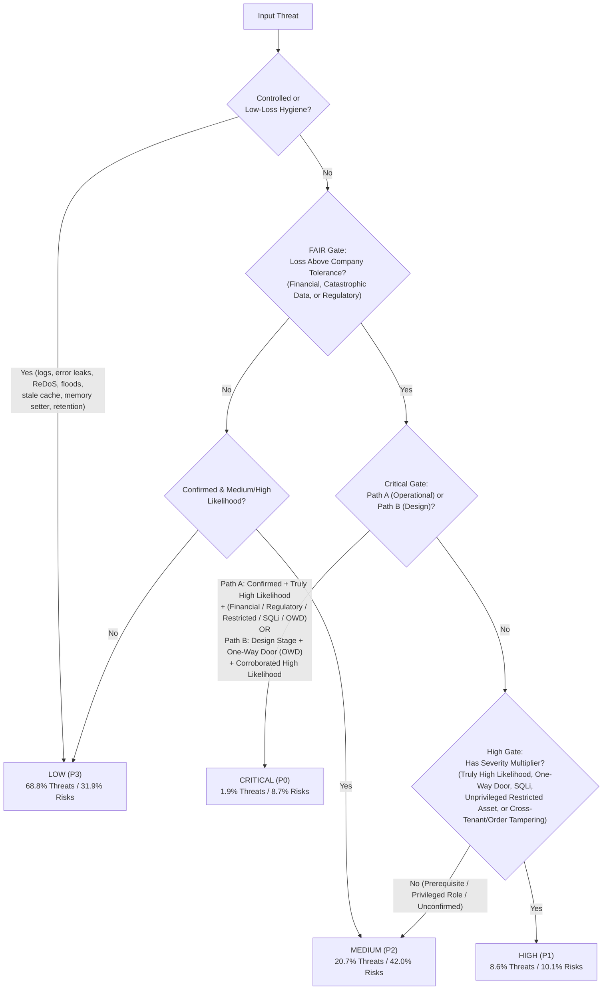

# Security Prioritization Framework (FAIR + SSVC + Boehm One-Way Doors)

A research-backed, zero-dependency Python framework and benchmark for eliminating security alert fatigue while keeping true critical risks and irreversible architectural flaws at the top.

---

## Objective Function

Every candidate prioritization model is evaluated against seven quantitative and qualitative constraints (`evaluate_objective_function` and `evaluate_risk_objective_function` in `prioritization.py`):

1. **Criticals (`critical` / `P0`) $< 10\%$** globally and within every individual project.
2. **Highs (`high` / `P1`) $\approx 10\%$** (`7%–13%`, with `Critical + High <= 20%`).
3. **FAIR Loss-Tolerance Gate**: Critical and High issues require concrete loss above company tolerance — **Financial Loss**, **Catastrophic Data Loss**, or **Regulatory / Statutory Compliance Loss**. Worst-component-asset inheritance and two-way-door local hygiene (log redaction, error detail leaks, ReDoS/flooding, in-memory retention, startup config crashes, stale caches) are capped at Medium/Low.
4. **SSVC / EPSS True High Likelihood Gate**: Operational Criticals must be confirmed in code (`standing == "open"`) with truly high likelihood (`truly_high_likelihood == True`, e.g., external/unauthenticated exposure or systemic store-wide rules).
5. **Boehm / ATAM One-Way-Door Gate**: Design-stage Criticals must involve an **irreversible / high-migration-cost component** ("one-way door": cryptographic/webhook signature contracts, multi-tenant DB/storage isolation, unencrypted persistent stores, cross-boundary identity/trust architecture).

---

## Academic Foundation

- **CMU SEI / CISA SSVC (Stakeholder-Specific Vulnerability Categorization)** — Spring, Hatleback, Householder, Manion, Shick (2019/2021): decision-tree triage across exploitation/confirmation, exposure, and mission impact to compress the urgent "Act" tier under $10\%$.
- **EPSS (Exploit Prediction Scoring System)** — Jacobs, Romanosky, Edwards, Roytman, Adjerid (*Journal of Cybersecurity* / FIRST, 2021/2023): empirical exploitation modeling showing static severity inflates urgent alerts above $50\%$, whereas reachability/confirmation filters cut urgent volume below $10\%$.
- **FAIR (Factor Analysis of Information Risk)** — Freund & Jones (2014): $\text{Risk} = \text{Loss Event Frequency} \times \text{Loss Magnitude}$ gated against organizational **Risk Tolerance**.
- **Boehm Cost-of-Change & ATAM Irreversibility ("One-Way Doors")** — Boehm (*Software Engineering Economics*, 1981; Boehm & Basili, 2001) & Kazman et al.: prioritizing architectural/design choices whose downstream migration cost makes post-launch remediation prohibitive.

---

## Decision Flow (`model_5_unified_fair_ssvc_one_way_door`)



---

## Benchmark Results (522 Visible Threats, 69 Risks, 11 Anonymized Projects)

| Model | Critical | High | Medium | Low | Passed | Objective Penalty |
|---|---:|---:|---:|---:|:---:|---:|
| `model_1_baseline` (component-inheritance `impact_for`) | 227 (`43.5%`) | 167 (`32.0%`) | 69 | 8 | `False` | `712.10` |
| `model_2_iso27005_matrix` | 14 (`2.7%`) | 86 (`16.5%`) | 187 | 235 | `False` | `301.76` |
| `model_3_epss_reachability` | 69 (`13.2%`) | 21 (`4.0%`) | 80 | 352 | `False` | `502.84` |
| `model_4_cisa_ssvc` (strict direct asset) | 2 (`0.4%`) | 80 (`15.3%`) | 141 | 299 | `False` | `201.99` |
| **`model_5_unified_fair_ssvc_one_way_door`** | **10 (`1.9%`)** | **45 (`8.6%`)** | **108** | **359** | **`True`** | **`0.89`** |

**Risk Priority Distribution (`model_5_unified_fair_ssvc_one_way_door`)**:
- `P0 (Critical)`: **6 / 69 (`8.7%`)**
- `P1 (High)`: **7 / 69 (`10.1%`)**
- `P2 (Medium)`: **29 / 69 (`42.0%`)**
- `P3 (Low)`: **22 / 69 (`31.9%`)**
- `Unrated (Unreached)`: **5 / 69 (`7.2%`)**

---

## Usage

No third-party dependencies are required (`evaluate.py` runs with standard Python 3.10+):

```bash
python3 evaluate.py
pytest -v
```
